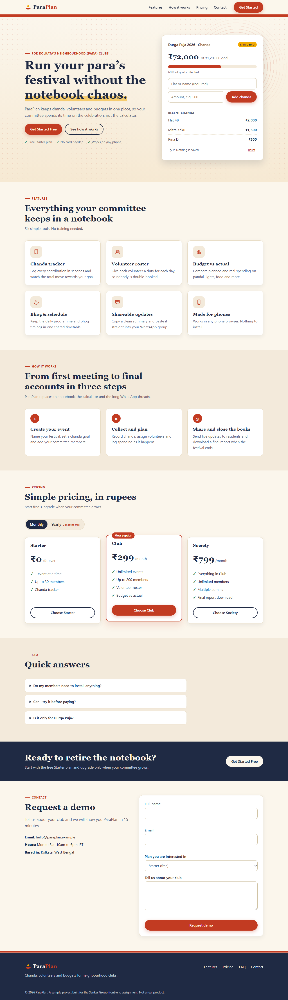
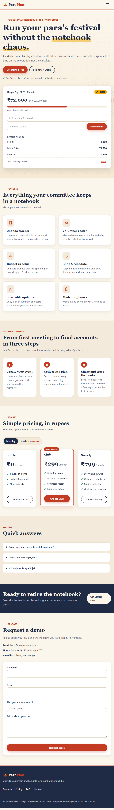
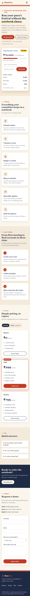

# ParaPlan: SaaS Landing Page

A responsive landing page for **ParaPlan**, an invented SaaS that helps Kolkata's neighbourhood
clubs and housing societies track chanda (donations), volunteers and budgets.
Built for the Sankar Group front-end internship assignment.

**Live site:** _not deployed yet (add the link here after deploying)_

## Screenshots

| Desktop (1280px) | Tablet (768px) | Phone (390px) |
|---|---|---|
|  |  |  |

## Features

- Sticky navbar with smooth-scroll links, a Get Started button and a hamburger menu on phones
- Hero with a **working chanda tracker** demo (a flat or name is required before an amount can be added; watch the bar and total update)
- Features (6 cards), How it works (3 steps), Pricing (3 plans with a monthly/yearly toggle)
- Plan buttons scroll to the contact form and pre-select that plan
- FAQ accordion (no JavaScript, uses `<details>`) and a closing call-to-action band
- Inline SVG icons and logo, and a hamburger icon drawn in CSS: no icon library and no emoji
- Demo request form with validation, per-field error messages and a success message (front-end only)
- Responsive from small phones to desktop; accessibility basics in the code (skip link, ARIA labels, focus outlines)

## Technologies

HTML5, CSS3 (custom properties, Grid, Flexbox, media queries), vanilla JavaScript.
No frameworks, no libraries, no external requests: system fonts and hand-drawn inline SVG icons.

## Run locally

1. Download or clone this repo.
2. Open `index.html` in a browser (it works straight from disk),
   **or** use the **Live Server** extension in VS Code,
   **or** run a tiny server from the project folder and open <http://localhost:5173>:

```bash
python -m http.server 5173
```

## Project structure

```
index.html          page structure (semantic sections)
css/style.css       all styling (mobile first, variables at the top)
js/main.js          menu, chanda tracker, pricing toggle, plan buttons, form validation
screenshots/        desktop, tablet and phone captures
```

## Design choices and challenges

1. ParaPlan is a specific, invented idea (software for neighbourhood clubs) rather than a generic task board, so the page has its own character while keeping the standard SaaS sections.
2. It uses plain HTML, CSS and JavaScript so structure, style and behaviour stay separate and easy to read; no build step or library is needed.
3. Colours, fonts, radii and spacing are defined once as CSS variables, and reusable classes (`.container`, `.section`, `.card`, `.btn`) keep the look consistent.
4. The CSS is mobile first, with breakpoints at 640, 768 and 900px added where the content needed them, not for specific devices.
5. Signature details: a red-white-red "lal-paar" stripe made from a single CSS gradient, a diya logo and feature icons drawn as inline SVG, a faint alpona-style ring behind the demo card, and rupee amounts grouped the Indian way with `Intl.NumberFormat('en-IN')`.
6. Interactions: hamburger menu, live chanda tracker, monthly/yearly price toggle, plan buttons that pre-select the contact form, and form validation with error and success messages.
7. Challenges solved: step numbers leaking from an `<ol>` reset, grey prices caused by CSS specificity, pricing cards not using tablet width, a logo wordmark split apart by flexbox `gap`, and demo names that were invented instead of typed (now a required field).
8. Limits: there is no backend, so the form does not send data; it was checked in one browser at several widths, not yet on real phones or other browsers.

## Notes

- Sample content and placeholder names only. ParaPlan is not a real product, and the email address uses the reserved `.example` domain.
- No passwords, API keys or private credentials are used anywhere.
- AI tools were used for product decisions, developing the idea and writing the page's code, as the assignment permits.
